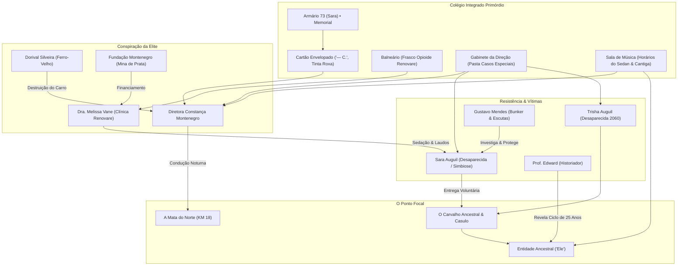

# DOSSIÊ COMPLETO DA CAMPANHA • FRAGKTUS & MINA DE PRATA
**Sistema:** Wuitalur RPG — *Fios do Medo*  
**Cenário:** Cidade de Fragktus & Mina de Prata  
**Documento de Referência Narrativa e Mecânica (Áreas, NPCs, Conspiração e Linha do Tempo)**

---

## 1. VISÃO GERAL DA TRAMA & NÚCLEO NARRATIVO

### 1.1. O Mistério Central: O Desaparecimento das Irmãs Auguil
Na madrugada de **1º de julho de 2061**, Sara Auguil (17 anos), aluna do tradicional Colégio Integrado Primórdio e herdeira do emblemático Café da Névoa, desapareceu sem deixar vestígios formais. A polícia local e a administração escolar classificaram sumariamente o caso como "fuga voluntária de adolescente rebelde", recusando investigações aprofundadas.

Por trás da narrativa oficial, oculta-se um ciclo macabro secular: exatamente um ano antes, em **dezembro de 2060**, a sua irmã mais velha, **Trisha Auguil**, havia desaparecido sob circunstâncias idênticas após resistir a pressões imobiliárias e financeiras da elite de Fragktus. Ambas foram diagnosticadas com enfermidades terminais/crônicas e sistematicamente preparadas, dopadas e entregues como oferenda à entidade ancestral que habita a floresta ao norte.

### 1.2. A Entidade Primordial: "Ele"
No coração da **Mata do Norte**, sob as raízes colossais do Carvalho Ancestral, reside um organismo primordial consciente conhecido pelos cultistas apenas como **"Ele"**.
- **Natureza:** Uma força simbiótica vegetal-mística da terra que absorve a matéria orgânica de seres humanos enfraquecidos ou desenganados, preservando as suas consciências, memórias e sentimentos em um "estado de repouso eterno e ausência total de dor".
- **O Pacto de Fragktus (1880):** A fundação e enriquecimento vertiginoso da cidade através das minas de prata foram consolidados através de um pacto de sangue e oferendas periódicas (a cada 25 anos ou em momentos de necessidade) celebrado pela dinastia **Montenegro**.

### 1.3. A Engrenagem Conspiratória
A condução dos sacrifícios opera através de uma rede institucional rigorosamente coordenada:
1. **O Colégio Primórdio (Constança Montenegro):** Mapeamento e vigilância de alunos fragilizados, doentes ou sem suporte familiar direto.
2. **A Clínica Renovare (Dra. Melissa Vane):** Emissão de laudos de incurabilidade, isolamento hospitalar e administração de sedativos alucinógenos infundidos com extrato vegetal da mata.
3. **O Condomínio Mina de Prata (A Elite):** Enclave de segurança máxima e recursos financeiros que financia a Fundação Montenegro e viabiliza as janelas cegas de transporte.
4. **O Ferro-Velho do Rato (Dorival Silveira):** Destruição de provas materiais, funilaria clandestina de veículos avariados nas incursões da mata e trituração de pertences.
5. **A Mata do Norte (O Ponto Focal):** Isolamento militarizado no KM 18 que impede o acesso civil até a clareira do Carvalho Ancestral.

---

## 2. LINHA DO TEMPO CANÔNICA DOS ACONTECIMENTOS

| Data / Período | Evento Narrativo | Detalhes & Evidências |
| :--- | :--- | :--- |
| **1880** | Fundação de Fragktus & Primeiro Pacto | A família Montenegro estabelece o pacto com a entidade na antiga mina para garantir a prosperidade mineral da colônia. |
| **Dezembro de 2060** | Desaparecimento de Trisha Auguil | Trisha recusa vender o Café da Névoa para empresas de fachada de Constança. É dopada na Clínica Renovare e transportada para a mata. O guarda florestal tenta intervir e é consumido pelas raízes. |
| **Início de 2061** | Início das Investigações de Gustavo e Sara | Gustavo Mendes é expulso da corporação policial por insistir nas buscas por Trisha. Ele monta o bunker seguro e une forças com Sara Auguil. |
| **Março de 2061** | Diagnóstico Terminal de Sara | Dra. Melissa Vane atesta sarcoma incurável estágio IV. Começa o trabalho de persuasão psicológica para empurrar Sara para a órbita da diretora Constança. |
| **18 de Junho de 2061** | O Pacto no Beco do Café da Névoa | Um gato de rua possuído pela entidade manifesta-se a Sara no beco dos fundos, prometendo o fim de suas dores lancinantes e o reencontro com Trisha nas árvores. |
| **30 de Junho de 2061 (Noite)** | A Preparação Final | Sara é retirada em cadeira de rodas da Clínica Renovare sob sedação química pesada e levada para o quarto em Mina de Prata. |
| **01 de Julho de 2061 (00h45 - 01h30)** | O Apagão na Guarita | O vigia Valdir recebe suborno e ordens de Constança para desligar a iluminação perimetral e deletar gravações de câmeras da guarita de Mina de Prata. |
| **01 de Julho de 2061 (02h14)** | O Transporte até a Floresta | Constança conduz Sara no banco do passageiro de seu sedan preto pela estrada do KM 18 (flagrado pelas câmeras ilegais do Rato). |
| **01 de Julho de 2061 (02h30)** | A Entrega na Clareira | Sara desce do veículo e caminha descalça pela lama até o Carvalho Ancestral, fundindo-se simbioticamente com as raízes. |
| **01 de Julho de 2061 (04h30 - Manhã)** | A Queima de Arquivos | Constança despacha o sedan com para-choque avariado para o Ferro-Velho do Rato para substituição de peças e compactação industrial de sucatas. A escola autoriza o memorial de flores no armário 73 como cortina de fumaça. |

---

## 3. DOSSIÊ COMPLETO DE PERSONAGENS (NPCS)

### 3.1. Sara Auguil • A Jovem Desaparecida
* **Identidade & Papel:** Vítima Central do Desaparecimento e Ponto Focal da Conspiração (17 anos, estudante do 2º Ano e herdeira do Café da Névoa).
* **Personalidade:** Sensível, resiliente, dedicada à memória de Trisha e esgotada pelo sofrimento físico causado pelo sarcoma ósseo metastático.
* **Histórico Detalhado:** Perdeu os pais cedo e viu sua irmã Trisha sumir sem respostas em 2060. Dedicou meses a juntar pistas com Gustavo Mendes, até que o avanço irreversível do tumor passou a minar sua resistência. Manipulada pela promessa de paz eterna e de reencontro espiritual, aceitou a condução de Constança na noite de 31 de junho.
* **Informação de Domínio Público:** Conhecida como aluna exemplar, introvertida e querida pelos colegas; seu sumiço repentino gerou comoção e tributos no colégio.
* **Segredo Confidencial (Apenas Mestre):** A sua mente e alma estão em perfeita comunhão e paz simbiótica com a entidade sob o carvalho; uma extração cirúrgica forçada causaria sua morte biológica imediata.
* **Gatilho de Revelação:** Ocultismo ou Percepção (DT 8) no interior do Casulo Subterrâneo na Mata do Norte.
* **Vínculo na Trama:** Liga o Colégio Primórdio, o Café da Névoa, a Clínica Renovare e a Clareira do Carvalho Ancestral.

---

### 3.2. Gustavo "Gus" Mendes • Ex-Investigador & Confidente
* **Identidade & Papel:** Aliado-Chave dos Jogadores e Vítima Secundária (Ex-policial, especialista em vigilância e rádio).
* **Personalidade:** Paranoico, hipervigilante, fumante compulsivo e exausto. Alterna entre crises de urgência ansiosa e lucidez investigativa cirúrgica.
* **Histórico Detalhado:** Amigo de infância da família Auguil. Ao investigar o sumiço de Trisha em 2060, teve sua carreira destruída por ordem da Fundação Montenegro. Instalou uma central clandestina de receptores de rádio e passou a monitorar a rotina da diretoria até a noite em que Sara desapareceu.
* **Informação Livre:** Esclarece que Sara não fugiu por rebeldia juvenil, que estava com dores insuportáveis e que Constança e a Dra. Melissa estavam cercando a jovem para forçar sua transferência.
* **Segredo Confidencial (Apenas Mestre):** Possui a fita de áudio gravada onde a voz gélida de Constança diz: *"O caminho está preparado, Sara. Trisha está esperando"*. Conhece a tubulação subterrânea de drenagem do Ferro-Velho que acessa a mata sem passar pelo bloqueio do KM 18.
* **Gatilho de Revelação:** Apresentar pertence autêntico de Sara, obter Sucesso em Diplomacia (DT 7) com juramento de justiça, ou Intuição (DT 8).
* **Vínculo na Trama:** Serve como mentor e ponto de apoio operacional seguro para o grupo de investigadores.

---

### 3.3. Diretora Constança Montenegro • Reitora & Matriarca do Culto
* **Identidade & Papel:** Cúmplice Principal / Mentora do Sacrifício (Reitora do Colégio Primórdio e matriarca da Fundação Montenegro).
* **Personalidade:** Aristocrática, impassível, formal e paternalista. Disfarça fanatismo ritual e crueldade sob um manto de "caridade piedosa e dever social".
* **Histórico Detalhado:** Descendente direta dos fundadores de 1880. Enxerga a entrega de jovens doentes como uma bênção misericordiosa que alivia o sofrimento terreno e ao mesmo tempo preserva o pacto de prosperidade mineral de sua linhagem.
* **Informação Livre:** Lamenta publicamente a enfermidade de Sara e afirma com sobriedade que a instituição prestou todo o suporte pedagógico, material e médico à estudante.
* **Segredo Confidencial (Apenas Mestre):** Ela própria dirigiu o sedan preto blindado na madrugada de 01/07 e entregou Sara na orla da clareira. Guarda no cofre do gabinete a pasta confidencial com as ordens de sacrifício rubricadas em tinta roxa.
* **Gatilho de Revelação:** Confrontá-la com o cartão escrito em tinta roxa, com os laudos do cofre (Intimidação DT 9) ou com as filmagens da guarita (Investigação DT 8).
* **Vínculo na Trama:** Antagonista central no plano institucional e social.

---

### 3.4. Dra. Melissa Vane • Diretora Clínica da Renovare
* **Identidade & Papel:** Cúmplice Médica e Beneficiária Financeira (Diretora Técnica do Complexo Hospitalar Renovare).
* **Personalidade:** Fria, calculista, metódica e defensiva. Reage com arrogância a questionamentos éticos, mas demonstra pavor quando confronted com o caso de Trisha de 2060.
* **Histórico Detalhado:** Médica particular da elite de Fragktus. Manipulou prontuários para atestar sarcoma metastático irreversível em Sara e receitou coquetéis com extratos da flora da mata para induzir transe hipnótico receptivo.
* **Informação Livre:** Declara que Sara solicitou transferência sigilosa para cuidados paliativos domiciliares sob a tutela da diretora escolar.
* **Segredo Confidencial (Apenas Mestre):** Beneficiária de uma apólice de seguro de vida de 2 milhões de reais no nome de Sara e detentora dos relatórios de telemetria que registraram o momento da fusão de Sara com as raízes.
* **Gatilho de Revelação:** Apresentar frascos de opioides furtados da farmácia (Medicina DT 7 ou Investigação DT 7) ou ameaçar denúncia formal no Conselho Médico (Intimidação DT 8).
* **Vínculo na Trama:** Fornece o alicerce farmacológico e pseudo-científico do esquema.

---

### 3.5. Dorival "O Rato" Silveira • Receptador do Ferro-Velho
* **Identidade & Papel:** Testemunha Comprada e Eliminador de Provas (Proprietário do Ferro-Velho da Periferia Norte).
* **Personalidade:** Cínico, covarde, ganancioso e oportunista. Não possui lealdades ideológicas; coopera apenas sob ameaça física ou lucro financeiro imediato.
* **Histórico Detalhado:** Presta serviços clandestinos para a família Montenegro, recebendo verbas sob disfarce de reciclagem ecológica para triturar automóveis acidentados e incinerar mochilas e uniformes escolares comprometedores.
* **Informação Livre:** Nega conhecimento sobre estudantes sumidas e reclama que a polícia e as viaturas de segurança privada perturbam seu negócio.
* **Segredo Confidencial (Apenas Mestre):** Possui as gravações das câmeras ilegais da estrada mostrando o carro de Constança na noite do sumiço e guardou peças avariadas do para-choque impregnadas de resina de pinheiro para extorsão futura.
* **Gatilho de Revelação:** Intimidação física (DT 6), suborno em dinheiro vivo (500 moedas) ou chantagem sobre desmanches ilegais (Lábia DT 7).
* **Vínculo na Trama:** Elo material entre a cidade e a rota clandestina para a reserva florestal.

---

### 3.6. Prof. Edward Fontes • Historiador & Arquivista Regional
* **Identidade & Papel:** Aliado Acadêmico e Guardião da Memória (Professor titular de História no Colégio Primórdio há 30 anos).
* **Personalidade:** Erudito, esquivo, amedrontado e melancólico. Expressa-se por parábolas históricas e metáforas para testar o discernimento de seus interlocutores.
* **Histórico Detalhado:** Reuniu clandestinamente certidões de óbito, crônicas paroquiais de 1880 e jornais censurados de 1910, descobrindo o padrão cíclico de 25 anos em que jovens desaparecem na mata.
* **Informação Livre:** Relata a narrativa oficial de fundação de Fragktus e pontua sutilmente que o progresso da cidade sempre foi sustentado por sacrifícios silenciados.
* **Segredo Confidencial (Apenas Mestre):** Guarda o manuscrito de 1910 detalhando a anatomia mística de "Ele" e compreende que a floresta não é apenas uma área verde, mas o corpo de um ser primordial antigo.
* **Gatilho de Revelação:** Demonstrar proficiência em Ocultismo ou História Regional (DT 6) e garantir compromisso com a verdade.
* **Vínculo na Trama:** Fornece o contexto histórico e esotérico necessário para decifrar a entidade.

---

## 4. ÁREAS CANÔNICAS ATIVAS NO SISTEMA

---

### 4.1. Colégio Integrado Primórdio (`colegio-primordio`)
* **Distrito:** Setor Estudantil & Cívico • Centro de Fragktus
* **Nível de Risco:** Inspetores Rígidos & Vigilância Escolar (Nível de Alerta: Amarelo)
* **Condições & Requisitos de Acesso (Exclusivo Mestre):** Aberto ao público das 07h00 às 18h30 com uniforme escolar ou credencial de visitante. Acesso noturno requer arrombamento do portão lateral (Ladinagem DT 6) ou despistar a ronda dos inspetores de pátio.
* **NPCs Presentes:** Gustavo Mendes, Diretora Constança Montenegro, Prof. Edward Fontes, Sara Auguil (em memória).
* **Conexões de Saída:** A Mata do Norte (`floresta-proibida`) via rodovia vicinal ao norte.

#### Atmosfera & Cenário Oficial
> A arquitetura impõe-se de forma rígida e asseada. Os corredores longos possuem pisos de mosaico polido que refletem uma luz fluorescente pálida, ladeados por filas intermináveis de cacifos de metal verde-oliva. Os passos ecoam de forma seca e solitária nas paredes frias, transmitindo a sensação constante de vigilância e de que as conversas nunca são verdadeiramente privadas. No pátio central e no ginásio, a grandiosidade da infraestrutura serve apenas para reforçar a pequenez e a vulnerabilidade de quem ali estuda.
> 
> O ar carrega uma mistura enjoativa de cera de polir, papel velho da biblioteca e desinfetante forte — o aroma da limpeza extrema, usado pela direção para apagar rapidamente qualquer vestígio de fraqueza, dor ou escândalo. Durante as aulas, um silêncio opressivo domina os pisos, quebrado apenas pelo tiquetaque rígido dos relógios de parede e pelo som distante e calculista de sapatos de salto alto a ecoar no rés-do-chão.
> 
> A pressão social paira densa nos intervalos. Os alunos, filhos da elite local, agrupam-se com posturas impecáveis e olhares de julgamento, criando um ecossistema hostil a quem não partilha do mesmo estatuto. É um espaço claustrofóbico e profundamente hipócrita, onde o arranjo de flores mortas no corredor contrasta com a ordem imaculada da instituição, provando aos investigadores que o sofrimento ali não é tratado, mas sim silenciado de imediato.

#### Pontos de Interesse Estruturados (PDIs):

##### PDI 1: O Armário de Sara (2º Andar, Corredor Norte)
* **Cabeçalho:** O armário metálico nº 73, situado no corredor entre a biblioteca e a sala do 3º ano. O chão em frente e a chapa verde-oliva acolhem um memorial improvisado: vasos pequenos com cravos secos, crisântemos murchos, copos de plástico com cera endurecida de velas e várias mensagens coladas com fita-cola. A porta está encostada apenas no fecho metálico, sem cadeado.
* **Testes de Perícias:**
  * **Investigação (DT 6):** Ao inspecionar a estrutura física e afastar o amontoado de flores da base, nota-se que as homenagens foram fixadas em momentos distintos. Entre papéis banais de estudantes, há um envelope denso colado com fita-cola na lateral de acesso mais difícil, bem rente à dobra da porta.
  * **Percepção (DT 6):** Pelas grelhas de ventilação do metal escapa um odor químico de desinfetante hospitalar forte misturado com cera perfumada de flor de laranjeira, destoando completamente do pó e mofo do corredor.
  * **Ladinagem / Crime (DT 8):** O trinco interior do armário não ostenta mossas, marcas de ferramentas ou sinais de gazua. Ele foi destrancado com a chave-mestra administrativa da coordenação antes da colocação das flores.
  * **Intuição (DT 6):** A disposição das velas e das jarras não parece puramente espontânea: segue uma ordem excessivamente simétrica e limpa, típica de algo inspecionado ou supervisionado pela própria coordenação escolar.
* **Notas do Mestre:** A diretora Constança Montenegro acedeu ao armário com a chave-mestra poucas horas após os boatos do desaparecimento de Sara. Ela higienizou o interior para remover resquícios de medicação e autorizou o memorial como cortina de fumo. Uma busca bem-sucedida revela o Cartão Envelopado.

##### PDI 2: O Cartão Envelopado (Encontrado no Armário)
* **Cabeçalho:** Um envelope de alta gramagem, feito de papel de linho texturado, sem remetente formal no exterior. No interior, há um cartão dobrado com a seguinte inscrição manual em caligrafia cursiva elegante: *"Que as tuas dores finalmente encontrem repouso sob a sombra do eterno silêncio. Foste corajosa ao aceitar o descanso que merecias. — C."*
* **Testes de Perícias:**
  * **Investigação (DT 6):** O papel de linho e o corte do envelope correspondem exatamente aos materiais de expediente solene utilizados em exclusivo pela direção do Colégio Primórdio.
  * **Percepção (DT 6):** A tinta utilizada na escrita é fluida, própria de caneta de tinta permanente num tom púrpura escuro, impregnando um perfume suave de essência floral no papel.
  * **Intuição (DT 8):** A mensagem encara a ausência de Sara como um termo definitivo e consumado, denotando que o autor conhecia a sua enfermidade latente ("as tuas dores") e sabia que a jovem partiu de livre vontade.
* **Notas do Mestre:** O cartão foi depositado discretamente no memorial por Constança Montenegro. A tinta roxa é o seu cunho pessoal em despachos formais. O bilhete entrega aos jogadores que alguém com a inicial "C" na escola sabia do cancro terminal de Sara e apoiou a sua entrega à entidade.

##### PDI 3: O Balneário do Ginásio (1º Andar, Rés-do-chão - Ala Este)
* **Cabeçalho:** Um banco de madeira comprido fixo aos azulejos frios nos fundos do balneário feminino da quadra, próximo à saída de emergência que conduz às traseiras do recinto escolar.
* **Testes de Perícias:**
  * **Investigação (DT 6):** Sob o assento do último banco encontram-se resíduos de fita-cola recente. No vão do ralo desativado logo abaixo, foi descartado um frasco cilíndrico de remédio vazio e sem rótulo comercial, preservando apenas um código impresso da Clínica Médica de Mina de Prata.
  * **Percepção (DT 8):** Na parede de azulejos, atrás da fila de armários, alguém usou a ponta metálica de um compasso para riscar na argamassa: *"O gato preto estava no pátio outra vez. Ele olhou para mim da árvore."*
  * **Medicina / Alquimia (DT 6):** O odor residual no frasco de vidro pertence a analgésicos opioides pesados, prescritos estritamente para o alívio de dor crónica severa em estágios avançados de tumores terminais.
* **Notas do Mestre:** Sara lidava com episódios frequentes de náuseas e dores intensas. Com medo de que o seu estado de saúde fosse exposto perante a comunidade elitista do colégio, ela escondia-se no balneário vazio para se medicar em segredo.

##### PDI 4: O Gabinete da Direção (1º Andar, Rés-do-chão - Ala Oeste)
* **Cabeçalho:** A secretária imponente de carvalho escuro de Constança Montenegro e um armário de arquivos de aço cinzento encastrado na alvenaria atrás da sua poltrona de cabedal, protegido por uma fechadura cilíndrica de latão.
* **Testes de Perícias:**
  * **Ladinagem / Crime (DT 8):** Destrancar o compartimento inferior do arquivo de aço sem entortar a lingueta de metal nem disparar o alarme mecânico instalado no batente da porta.
  * **Investigação (DT 6):** No fundo da gaveta há uma pasta suspensa rotulada *"Transferências & Saúde - Casos Especiais"*, contendo os relatórios de Trisha Auguil (ano letivo de 2060) e Sara Auguil (2061), acompanhados de cópias de laudos médicos confidenciais.
  * **Intuição (DT 8):** Agrafado ao laudo de Sara há um bilhete escrito com caneta de tinta permanente roxa: *"Degeneração celular incurável confirmada. Perfil dócil e sem suporte familiar direto. Proceder com a apresentação à Névoa."*
* **Notas do Mestre:** Prova documental direta do papel de Constança. A diretora usa a sua posição de autoridade para mapear jovens desamparados e doentes graves, encaminhando-os para a entidade "Ele" em troca de manter o seu pacto de influência e prosperidade em Fragktus.

##### PDI 5: A Sala de Música (2º Andar, Ala Sul)
* **Cabeçalho:** O piano de cauda negro encostado junto às cortinas pesadas de veludo na sala de ensaio com isolamento acústico, cercado por estantes de partituras e violinos guardados em caixas de madeira.
* **Testes de Perícias:**
  * **Investigação (DT 6):** Sob as cordas de aço da caixa de ressonância do piano, há uma folha pautada de partitura com uma lista manuscrita de horários de saída e entrada do carro particular de Constança durante as madrugadas de junho.
  * **História / Ocultismo (DT 8):** No verso da partitura, há anotações manuais que transcrevem uma cantiga arcaica de Fragktus sobre *"Aquele que habita sob as raízes e aceita os que não possuem futuro"*.
  * **Percepção (DT 6):** O fecho da janela das traseiras está destravado e há marcas de terra seca no parapeito, indicando que o local servia de passagem clandestina para a passarela exterior do ginásio.
* **Notas do Mestre:** A sala de música era o esconderijo que Sara usava para tentar compreender o que a entidade havia falado por intermédio do gato possuído e para monitorizar as movimentações noturnas da diretora Constança antes de desaparecer de vez.

---

### 4.2. A Mata do Norte (`floresta-proibida`)
* **Distrito:** Reserva Florestal Fechada • Zona Rural
* **Nível de Risco:** Fauna Alterada, Névoa Tóxica & Armadilhas (Nível de Alerta: Vermelho)
* **Condições & Requisitos de Acesso (Exclusivo Mestre):** Área formalmente isolada com cancelas militarizadas no KM 18 guardadas por vigilantes armados da Fundação Montenegro. Entrada clandestina viável pela tubulação de drenagem do Ferro-Velho (Atletismo DT 6) ou ravinas laterais de serra.
* **NPCs Presentes:** Sara Auguil, Constança Montenegro.
* **Conexões de Saída:** Colégio Integrado Primórdio (`colegio-primordio`) via estrada principal pavimentada.

#### Atmosfera & Cenário Oficial
> Árvores centenárias retorcidas, neblina espessa que engole os faróis, silêncio sepulcral quebrado pelo estalar de galhos e arame farpado enferrujado sob o chão de terra úmida coberto por seiva escura aromática.

#### Lore & Rumor
* **História Local:** Área de preservação ambiental isolada sob o pretexto de contaminação química e risco de desmoronamento de galerias coloniais. Na realidade, guarda as clareiras onde os pactos de sangue são selados há mais de um século.
* **Rumor Investigativo:** *"Guardas florestais privados não usam fardas do Estado: usam coletes pretos táticos e atiram sem aviso contra qualquer um que passe da cerca do KM 18."*

---

## 5. ÁREAS ADJACENTES DA CIDADE DE FRAGKTUS (ARQUIVO HISTÓRICO)

Para referência do Mestre e futuras expansões modulares da campanha, estas são as outras cinco localidades que compõem o ecossistema urbano:

### 5.1. Condomínio Mina de Prata (`mina-de-prata`)
* **Distrito:** Residencial de Alta Renda • Zona Sul de Fragktus
* **Atmosfera:** Mansões neoclássicas, ruas silenciosas de paralelepípedo molhado, câmeras ocultas com IA e portões de ferro forjado.
* **Pontos Críticos:** Mansão Auguil (quarto de Sara com gaveta de fundo falso contendo morfina), Guarita Principal (onde o vigia Valdir desligou câmeras entre 01h00 e 01h30), Lote 14 da Alameda dos Ipês (ponto cego onde o SUV de Constança aguardou Sara).

### 5.2. Café da Névoa (`cafe-da-nevoa`)
* **Distrito:** Bairro Operário & Boêmio • Centro Velho
* **Atmosfera:** Luz lilás tênue, aroma de café torrado e asfalto molhado, vinil chiando na vitrola antiga e janelas embaçadas por vapor.
* **Pontos Críticos:** Beco dos Fundos (local onde Sara selou o pacto com o gato de olhos de âmbar), Mesa 4 (com escuta oculta registrando a Dra. Melissa empurrando Sara para a diretora), Porão sob o alçapão (usado por Gustavo como base temporária).

### 5.3. Clínica Renovare (`clinica-renovare`)
* **Distrito:** Complexo Médico Privado • Zona Nobre de Fragktus
* **Atmosfera:** Paredes de porcelanato imaculado, luzes frias em tom azulado, cheiro de ozônio e éter, portas com travas biométricas.
* **Pontos Críticos:** Consultório 402 da Dra. Melissa (prontuário original com ordem de entrega), Farmácia Central (frascos de alcaloides da seiva da mata), Incinerador do Subsolo (fivelas metálicas da bolsa de Trisha queimada em 2060).

### 5.4. Ferro-Velho do Rato (`ferro-velho`)
* **Distrito:** Distrito Industrial & Sucata • Periferia Norte
* **Atmosfera:** Montanhas de carcaças enferrujadas sob fuligem cinzenta, poças viscosas de óleo diesel e latidos ferozes de molossos de guarda.
* **Pontos Críticos:** Contêiner do Rato (recibos de propina e placa do sedan de Constança), Prensa Hidráulica (lascas de tinta e cascas de pinheiro no para-choque compactado), Túnel de Drenagem (galeria de 1,5m que sai diretamente na mata).

### 5.5. Refúgio do Gustavo (`refugio-gustavo`)
* **Distrito:** Bunker Subterrâneo Clandestino • Localização Confidencial
* **Atmosfera:** Luz de emergência vermelha, paredes forradas de cortiça com teias de lã vermelha conectando fotos e recortes, ruído constante de rádio militar.
* **Pontos Críticos:** Mural Conspiratório (conecta a mansão Montenegro, a clínica e o ferro-velho), Terminal Air-Gapped (vídeos em alta definição da saída do sedan de luxo), Bancada de Antídotos (ampolas formuladas para anular a sedação química).

---

## 6. MAPA DE RELACIONAMENTOS & FLUXO DE PISTAS

---

## 7. DILEMA MORAL & CONCLUSÃO DA INVESTIGAÇÃO

O desenlace narrativo não coloca os jogadores diante de um mero resgate de refém, mas de um confronto ético e espiritual:
1. **A Verdade dos Fatos:** Sara não foi raptada violentamente por um assassino comum. Fragilizada pelas dores lancinantes de um sarcoma metastático terminal e desamparada após a perda da irmã, foi manipulada e acolhida pela diretora Constança para cumprir o sacrifício histórico de Fragktus.
2. **O Estado de Sara:** Ao alcançarem o Carvalho Ancestral, os investigadores constatam que Sara e Trisha encontram-se em repouso eterno e pacífico, com as suas consciências preservadas pela entidade e libertas do tormento físico da doença.
3. **A Escolha dos Investigadores:**
   - **Expor a Conspiração:** Desmascarar Constança Montenegro, a Dra. Melissa Vane e a elite de Fragktus perante as autoridades, derrubando a hipocrisia da fundação ao custo de abalar a cidade.
   - **Respeitar o Descanso:** Compreender que perturbar as raízes causaria a morte biológica imediata das irmãs, decidindo como lidar com os cúmplices sem destruir o pacto ancestral que impede a floresta de engolir a região.

---
*Dossiê compilado automaticamente para o Mestre — Sistema Wuitalur RPG (Fios do Medo).*
